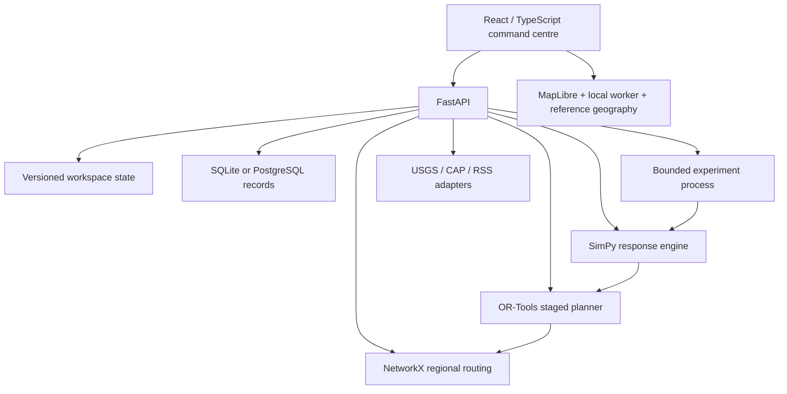
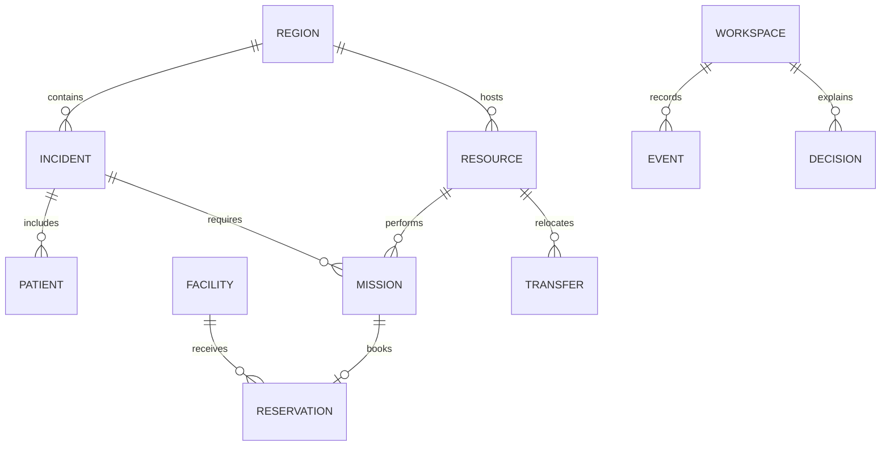

# Architecture and detailed design

## Components



One API process owns interactive updates. Each anonymous workspace is protected by an in-process lock; every mutation increments its revision. Preview plans are stored with their owner and revision. Applying a plan checks both before reserving resources. Run Uvicorn with **one application worker** for this prototype. Experiment execution uses a separate spawned process and a bounded submission queue.

Playback steps also carry the expected workspace revision. A delayed or repeated command based on an older state is rejected without advancing time. The frontend serialises playback requests, pauses on transport failure, and reloads authoritative state after reconnection. It never automatically retries a mutation whose response may have been lost.

Experiment progress uses database compare-and-swap writes across API and worker processes. Cancellation is terminal, and unfinished jobs are marked interrupted when the API restarts. The local launcher verifies the service identity and starts a detached process; Docker uses foreground process management.

The frontend uses the same origin as the API in production. SSE announces state revisions, and ordinary API requests fetch authoritative state. Playback advances simulated time explicitly; it does not dispatch real emergency services. Tests use the built production application.

## Response workflow

1. A reported incident exposes patient demand and, optionally, an evacuation group.
2. Its playbook identifies the specialist rescue capability and service prerequisites.
3. The rescue allocation model selects available asset/crew pairs.
4. Road, water or configured air travel determines response and transfer times.
5. Medical and non-medical rescue batches have separate readiness times. Transport can begin for patients before all group evacuation trips finish.
6. Patient allocation jointly selects a compatible ambulance and hospital.
7. The plan reserves vehicles and treatment intervals. Evacuation reserves bus seats and shelter places.
8. Simulation advances through response, rescue, transport, handover, treatment and resource release.
9. Updated conditions affect pending plans and subsequent travel legs.

## Algorithms

### Routing

Imported road packages use directed NetworkX graphs. Each edge has geometry, distance and assumed travel time. Shortest paths minimise edge travel time multiplied by the scenario traffic factor. Closures remove directed edges from the routing view. Disconnected destinations produce an explicit infeasible result.

The import tool retains a strongly connected road component. The compaction tool contracts intermediate geometry points while retaining directed connections and original road geometry. Synthetic regional grids are an explicit alternative when no imported package exists. Water and air links are scenario corridors; cross-region links use distance-based transport estimates.

### Local rescue allocation

Binary variables represent candidate incident/resource pairs. Each incident receives at most one rescue assignment per cycle; each available specialist resource receives at most one assignment. The objective prioritises severity-weighted coverage and then estimated rescue readiness. Rescue transport accounts for multiple trips when the group exceeds vehicle capacity.

### Patient allocation

Candidate tuples identify a patient, suitable ambulance and reachable compatible hospital. Critical patients require an ALS ambulance. For each selected tuple:

```text
response = current_time + travel_to_pickup
departure >= max(response, rescue_ready) + stabilisation
arrival = departure + patient_transport
treatment_start >= arrival
```

Each patient and ambulance participate in at most one newly committed tuple. Hospital treatment is an optional interval; a cumulative constraint enforces the shared number of treatment bays, including existing occupancy and reservations.

The objective rewards severity-weighted served demand, penalises weighted treatment-start time, and uses travel distance as a small tie-breaker. Waiting adds to the allocation weight. Initial severity weights are **9, 4 and 1** for critical, serious and minor. These are research assumptions.

Candidate generation considers up to six suitable ambulances per patient and at most 60 pending patients per cycle. Larger queues remain explicit and are reconsidered. CP-SAT uses one worker, a deterministic search budget and a three-second wall-clock guard. `OPTIMAL` and `FEASIBLE` describe this bounded candidate model. A constraint-respecting greedy fallback handles unusable solver results.

### Evacuation and regional assistance

Evacuation allocates buses after rescue readiness, conserves people counts and respects shelter commitments. Regional pre-positioning uses CP-SAT to minimise total transfer time for requested available units while retaining each donor's configured reserve. A committed transfer makes the asset unavailable until its estimated arrival.

### Simulation

SimPy advances the virtual clock in increments no larger than one minute. State transitions retain their calculated event timestamps. Automatic dispatch is reconsidered on the three-minute grid and when an explicit advance begins. All benchmark policies receive identical advance boundaries.

Policies receive reported incidents only. Patient service durations are keyed to seed and incident identity, so assignment order does not change the generated patient requirements. Actual event and decision records are retained for replay.

## Data model

The prototype stores versioned JSON aggregates through SQLAlchemy's `records` table:

| Field | Meaning |
|---|---|
| `id` | UUID record key |
| `kind` | session, plan, placement, experiment, or alert import |
| `owner` | anonymous workspace identifier |
| `data` | versioned JSON document |
| `updated_at` | UTC persistence timestamp |

Within a workspace:



An asset includes a dedicated crew. Facilities store capabilities, baseline occupancy, treatment reservations and shelter counts. The state includes seed, initial scenario configuration, network fingerprints, applied decisions and event history. A normalised operational database with agency identities would be a subsequent deployment architecture.

## Main API surface

| Method and path | Purpose |
|---|---|
| `POST /api/sessions` | Create isolated simulation workspace |
| `GET /api/state` | Read authoritative state and metrics |
| `POST /api/reset` | Load a new exercise |
| `POST /api/incidents` | Record synthetic incident demand |
| `POST /api/plans` | Calculate an explainable allocation |
| `POST /api/plans/commit` | Validate and reserve a recommendation |
| `POST /api/advance` | Advance simulated time |
| `PATCH /api/conditions` | Change traffic, weather or road availability |
| `PATCH /api/resources/{id}` | Change availability of an uncommitted asset |
| `PATCH /api/facilities/{id}` | Change capacity or admissions |
| `POST /api/preposition` | Optimise regional placement |
| `POST /api/preposition/commit` | Schedule the selected transfers |
| `POST /api/experiments` | Queue a controlled multi-policy experiment |
| `GET /api/experiments/{id}/trace` | Inspect recorded event replay |
| `GET /api/export` | Export state, events or experiment results |
| `GET /api/alerts` | Retrieve separately labelled public observations |
| `POST /api/alerts/import` | Parse CAP/RSS without inferring casualties |

Interactive endpoints use the `X-Session-ID` header. Input bounds, ownership checks and revision checks are enforced on the backend. CAP parsing disables external entities. See `/docs` for the generated request schemas.

## Current model boundaries

The model makes a single new mission commitment per available resource per cycle. It is not a globally optimal schedule of all future emergencies. Current legs are committed; updated routes are computed at leg boundaries. Baseline occupied bays are released at scenario-defined times. Hospital treatment is a limited emergency-care stage rather than a full inpatient flow model.

No validated survival model, physical flood propagation, weather prediction, clinical diagnosis, or real 112/108 integration is included. The implemented outputs are response times, care times, congestion, resource use and unmet demand under stated assumptions.
